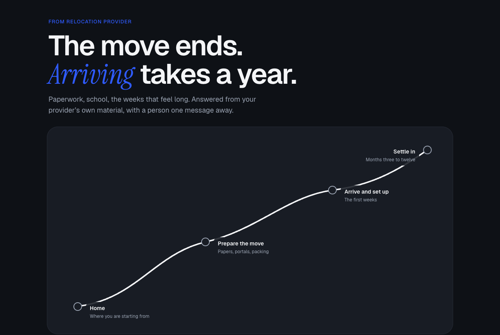
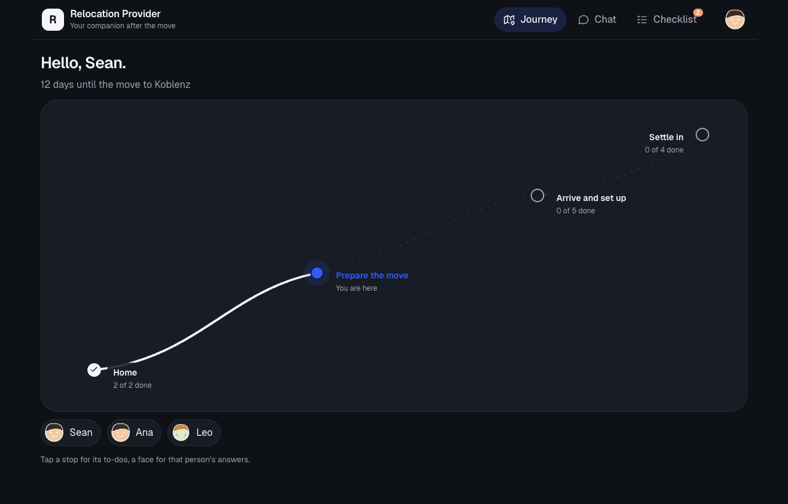

# Beyond Arrival

[](https://github.com/sean-mas/beyond-arrival-capstone/actions/workflows/ci.yml)
[](LICENSE)

A white-label AI companion that keeps supporting a relocated family after the
relocation provider's contract ends. A working prototype, built as the first
capstone of an AI product engineering programme.

**Try it:** [beyond-arrival-deploy.onrender.com/chat?demo=fresh](https://beyond-arrival-deploy.onrender.com/chat?demo=fresh)
(ask me for the access code; the free server takes about 30 seconds to wake up).
**Slides:** [the final presentation as PDF](delivery/final-2026-10-16/beyond-arrival-final.pdf).

<p>
  
  
</p>

**The gap.** A provider's contract closes around week six. The events that
decide whether the assignment works (Kita and school, health insurance, the
partner's work rights, a job search, loneliness) fall in months three to
twelve, when nobody is on contract any more.

## How it answers a message

```
message
  │
  ├─ 1 remove personal data        code     IBAN, phone, tax ID, address never reach a model
  ├─ 2 crisis check                model    qwen3.8 27B on Groq: does this need a person?
  ├─ 3 advice limits               code     no individual legal, visa or tax advice
  ├─ 4 find 6 card chunks          search   bge-m3 embeddings in Postgres/pgvector
  ├─ 5 write the answer            model    gpt-oss 120B, only from the cards
  └─ 6 check the answer            code     numbers and claims must be in the cards
```

Safety is decided in code; the models judge whether a message needs a person,
and write. The knowledge is 20 situation cards written for the provider
(`content/cards/`), split into 64 chunks.

## Results

**Retrieval.** Of the development cases that need a specific card, 0.947 find
it in the top 6 chunks; the curve is flat from 6 to 12, so 6 ships. Meaning-based
search beats a word-matching control (TF-IDF) by 0.21 at k = 6.
`docs/retrieval.md`, plots in `delivery/eda/`.

**Models against a baseline**, same 115 messages, prompt v3:

| Setup | Grounded | Relevant | Next step | Answered |
|---|---|---|---|---|
| Baseline 0: best card, pasted | 0.92 | 0.37 | – | 42 |
| Tier 1: llama3.1 8B, local | 0.71 | 0.56 | 0.34 | 60 |
| **Tier 2: gpt-oss 120B, hosted (ships)** | 0.86 | **0.81** | **0.79** | 61 |
| Tier 3: nemotron-3-ultra, hosted | 0.88 | 0.80 | 0.70 | 60 |
| Tier 4: gemma4 31B, hosted | 0.80 | 0.72 | 0.74 | 61 |
| *Judge agreement with human labels (Cohen's κ)* | *0.13* | *0.16* | *n/a* | |

The scores come from an LLM judge that agrees with the human labels barely
above chance (pass mark κ 0.6), so they show direction, not truth. The best
judge so far, gemma4 31B, reaches κ 0.00 / 0.21 / 0.38.

**Handing over to a person.** On 24 held-out posts, recall rose from 0.42 to
0.92 (11 of 12 that needed a person got one) and precision from 0.63 to 0.85.
The rules were tuned on these posts, so both numbers are fitted; the next honest
number needs a fresh labelled set.

**How it was improved.** One change per commit and per run, with a control run
first. Across seven experiments, code and content changes worked every time;
prompt rules worked only when they changed the shape of the reply.
`docs/decisions.md` holds every step and its numbers.

## Run it locally

Needs Docker, Python 3.12, [Ollama](https://ollama.com) with `bge-m3`, and API
keys for Ollama Cloud and Groq in `.env` (see `.env.example`).

```bash
make install
make db          # Postgres with pgvector
make ingest      # cards into the store
make demo        # the presented setup: http://localhost:8000/chat?demo=fresh
make check       # lint, types, tests, card validator
```

`make demo` pins the crisis check to qwen3.8 27B on Groq, as measured; `make
run` takes every setting from `.env`. The hosted deploy embeds queries with the
same bge-m3 on Cloudflare Workers AI (`make embed-parity PROVIDER=cloudflare`
checks the vectors agree).

## Status and limitations

A prototype for guided tests with relocation providers, not yet for families
on their own:

- **The judge is not calibrated.** No LLM judge has reached Cohen's κ 0.6
  against the human labels, so the model scores above show direction only.
- **The handover numbers are fitted.** Both the development and held-out sets
  were used to tune the crisis rules; an honest number needs fresh, labelled posts.
  The current rules also hand some mild messages to a person.
- **No memory and no family profile yet.** Each message is answered on its
  own, and the onboarding profile stays on the device. Both are the next build
  steps, with 20 test cases already written (`evals/personalisation.jsonl`).
- **Free tiers.** The demo sleeps when idle and shares a daily model quota.

## What is where

```
src/companion/   the agent, guardrails, retrieval and API
content/cards/   the 20 situation cards
evals/           runners, judge, calibration, constructed test cases
docs/            scope, requirements, decisions, evaluation design
docs/product/    problem, market, positioning, compliance, costs
architecture/    draw.io diagrams
delivery/        EDA plots and the presentation slides
tests/           unit tests, run on every push
```

## What is not in this repository

The 75 development cases and 24 held-out cases are posts harvested from
public expat forums. They are kept out on purpose: a short quote from a post
leads a search engine back to the person who wrote it. Only constructed cases
ship (`evals/adversarial.jsonl`, `evals/personalisation.jsonl`), and the
tests that read the harvested set skip here. The market-test notes and every
answer log are private for the same reason.
