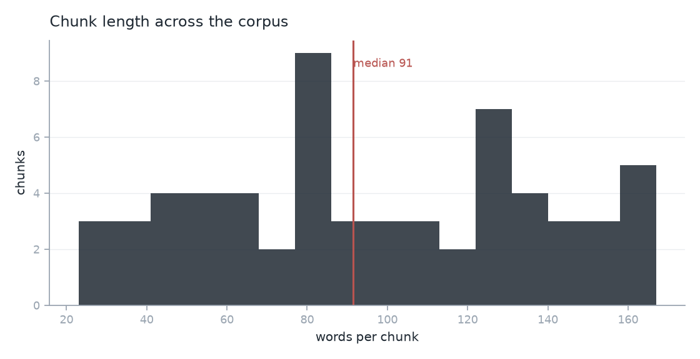
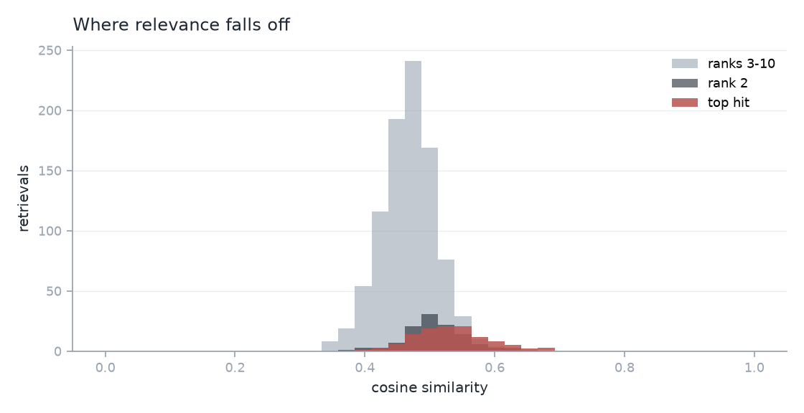
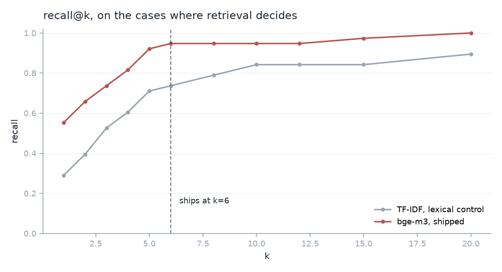

# EDA

Generated by `evals/eda.py` on the pinned embedding model.

- **Chunk length**: 62 chunks from 20 cards, 23 to 167 words, median 91. Split on the cards' own `## ` headings, so the spread is the corpus's shape rather than a window size.
- **Similarity**: top hit median 0.533, rank 2 0.507, ranks 3-10 0.468. The scale is compressed: the median top-to-second **margin is only 0.017**, and 57% of retrievals have a margin under 0.02. That is a finding rather than a detail, because `retrieval_margin` is one of the seven pre-registered fields and is meant to be a confidence signal. On this corpus it is a weak one, and the thesis should hear that before it leans on it.
- **recall@k** on the 38 cases where retrieval decides: k=1 0.553, k=6 0.947, k=12 0.947. Flat from 6 to 12, which is why k=6 ships.
- **Corpus balance**: strands {'life_setup': 8, 'orientation': 4, 'cultural_companion': 8}, audiences {'family': 12, 'partner': 6, 'employee': 1, 'child': 1}.
- **Near-duplicates**: 2 chunk pairs above cosine 0.8, closest card_008#1/card_009#1 at 0.833.

